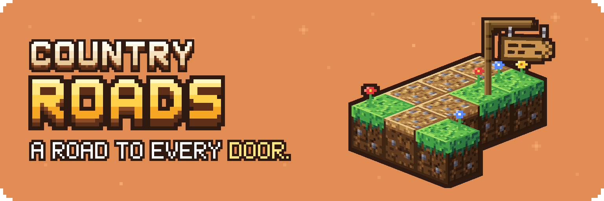

**A road to every door.** Country Roads gives your world roads that follow the land: through valleys, along rivers, over stone bridges and boardwalks, with signposts that say where they lead. They join villages as the world generates, and a Surveyor's Stake builds a path from your own front door. For Minecraft Java 26.3 on Fabric, Quilt, NeoForge and Forge.

- **Roads between villages.** They follow the land: valleys first, hillside cuts instead of sheer walls, tunnels through rock when that is shorter, stone arch and timber bridges, boardwalks over shallow water. The look follows the biome.
- **A look worth the walk.** Gallows signposts with the destination and the distance, lamp posts near villages, dry-stone walls and split-rail fences, wildflower verges, cairn milestones, lost carts, shrines, benches, hay carts, wheat fields in plains and the odd wayside camp.
- **Village streets that match.** The streets of vanilla villages get the road look, and every road joins the street at its edge.
- **Faster on the road.** You walk 20% faster on a road, mounts 30%. Monsters do not spawn on it, and roads are drawn on maps.
- **The Surveyor's Stake.** A path from your own door to the nearest road, free to build.
- **Old worlds too.** Chunks generated before you installed the mod get their roads when they load, as long as nobody has lived in them.

Craft the **Surveyor's Stake** from paper over two sticks (it makes two). Place it by your door, or right-click a door or fence gate with it. The mod finds the way to the nearest road over real terrain and shows it in particles. Right-click again to build it. It costs nothing: the path is graded three blocks wide, bridges rivers with a medieval bridge and tunnels through rock when that is shorter. Place more stakes to show it where to go. A small card on the right of the screen shows what the path is doing and which buttons do what. To make a path between two points that joins no road, place a second stake where it should end, then sneak and right-click a stake.

For 20 minutes you can take the path up again (left-click the door with the stake, or break the stake). After that it is part of the land, or sneak and right-click to keep it at once.

Open them in Mod Menu on Fabric and Quilt, or from the Mods list on NeoForge and Forge: walking and riding speed on roads, no monsters on roads, roads on maps, house paths and roads in old chunks, and for new worlds village streets, signposts and lamps, wayside camps, roadside finds and wheat fields. Gameplay settings apply at once. The world generation settings are copied into each world the first time it loads and stay fixed there.

Works with Terralith, Tectonic, Biomes O' Plenty, Geophilic, Dungeons and Taverns, Towns and Towers and Repurposed Structures: modded villages get roads too, and modded village streets are left as they are. On Fabric and Quilt it requires Fabric API; Mod Menu is optional there, for the settings screen.

Put the jar for your loader in your `mods` folder, for Minecraft 26.3: the `-fabric` jar on Fabric and Quilt (with Fabric API), the `-neoforge` jar on NeoForge, the `-forge` jar on Forge. Install it on the server and on the clients.

- Roads appear as chunks generate. Chunks you have already lived in are left alone.
- The roads are built from ordinary blocks.

<!-- promo:start -->

<!-- promo:end -->

Country Roads is free. If it saves you a long walk, a coffee helps fund the next update.

Want your own server to play on with friends? My BisectHosting affiliate link gives you 25% off the first month, and I get a small commission.

All rights reserved; see [LICENSE](https://github.com/ProfetGit/country-roads/blob/main/LICENSE).

Not an official Minecraft product. Not approved by or associated with Mojang or Microsoft.

